<p align="center">
  <picture>
    <source media="(prefers-color-scheme: dark)" srcset="docs/img/header_dark.png">
    
  </picture>
</p>

<h3 align="center">
Browse and interact with Codex more easily, and connect Codex with your terminal and workflow in one place.
</h3>

[](https://www.npmjs.com/package/codex-deck)
[](https://opensource.org/licenses/MIT)

<div align="center">
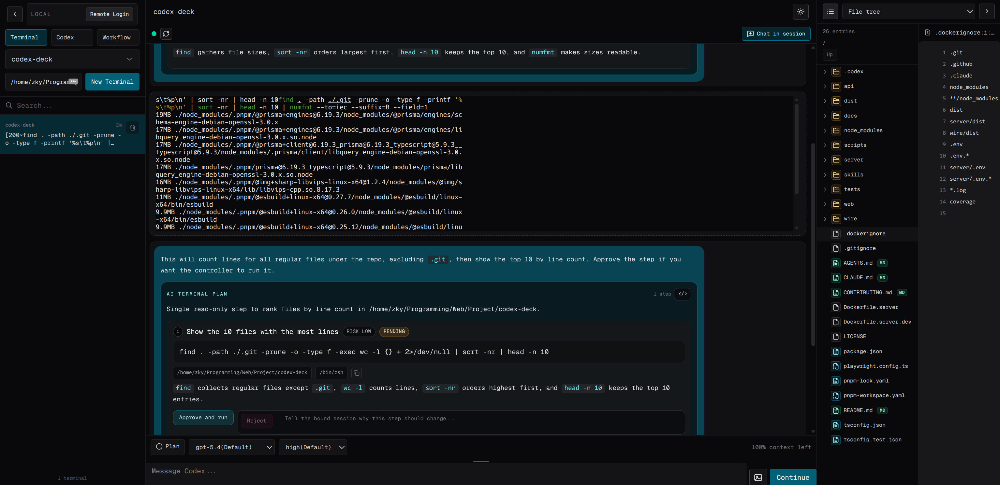
</div>
<h4 align="center">
AI Terminal brings Codex's AI capabilities to your terminal.
</h4>

<div align="center">
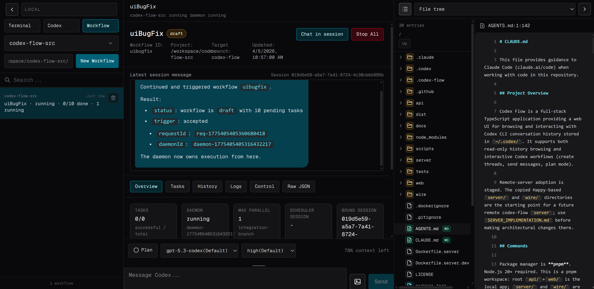
</div>
<h4 align="center">
AI Workflow lets you queue tasks, keep Codex working 24/7, and add new tasks at any time.
</h4>

## Features

Codex capabilities:

- **Session controls** - Stop generation, rename thread, fork thread, compact context, switch agent threads, and delete sessions.
- **In-browser messaging** - View and send messages across codex-deck instances with real-time updates.
- **Image attachments** - Attach images by drag/drop, paste, file picker, or mobile camera/gallery.
- **Model and reasoning controls** - Pick a model and reasoning effort per session and before sending.
- **Plan actions** - Use Plan mode and apply plan proposals.
- **`/`, `@`, and `$` support** - Use slash commands, file mentions, and skill mentions in the composer (similar to Codex CLI).
- **Live session list** - Real-time session updates with project filtering and session search.
- **Environment variables** - Pass environment variables into codex sessions.

Remote mode:

- **Local + remote connection modes** - Browse local `~/.codex` history or connect to a remote codex-deck server.
- **Local + remote updates together** - Pages stay in sync in both local and remote modes, with smooth switching between modes.
- **Network stability** - Provides a flexible experience in poor network conditions in remote mode.
- **Secure remote auth** - OPAQUE-based login flow with trust pins, saved browser auth restore, and machine selection.

UI design:

- **Mobile-friendly interface** - The UI is designed to adapt to mobile phone browsers.
- **Block mode** - View full, detailed message content in blocks.
- **Text mode** - Simplify less important message blocks into readable text lines.
- **Expandable blocks** - Toggle blocks between compact and expanded views, with clean copy behavior.

Code context and inspection:

- **Right pane diffs** - View `unstaged`, `staged`, or `last-turn` file diffs with patch rendering.
- **File tree + search + preview** - Browse the session file tree, search files, and open file content with code, image, and PDF previews.
- **Session skills pane** - Inspect and toggle skill enablement for the selected session.

AI-monitored task workflow:

- **Simple yet powerful task workflow scheduler** - Git-worktree-based workflows let users create workflows, adjust tasks, check status, and merge back into branches using natural language.
- **Workflow automation pane** - Create workflows with AI, bind sessions, launch tasks, view history/logs/raw JSON, send control messages, and manage daemon start/stop.
- **Tabbed workflow views** - Navigate workflow status and actions through `Overview`, `Tasks`, `History`, `Logs`, `Control`, and `Raw JSON`.
- **Bind tasks and Codex sessions** - Each agent/task in a workflow is tied to a Codex session.
- **Agent rules in workflow** - Persistent rules for agent tasks are supported in workflows.

Terminal:

- **Terminal workspace** - Create and manage multiple live terminals with shared read and ownership-based write control.
- **Background terminal runs** - Inspect per-session terminal run history/output with real-time updates.

### Feature previews:

- Terminal & Workflow & Codex
<div align="center">
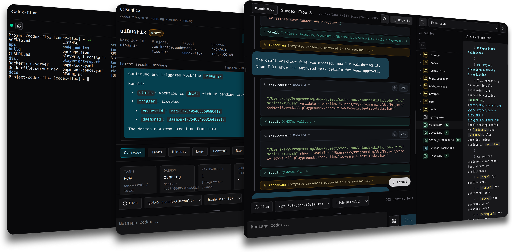
</div>

- Block mode vs Text mode

  <div align="center">
  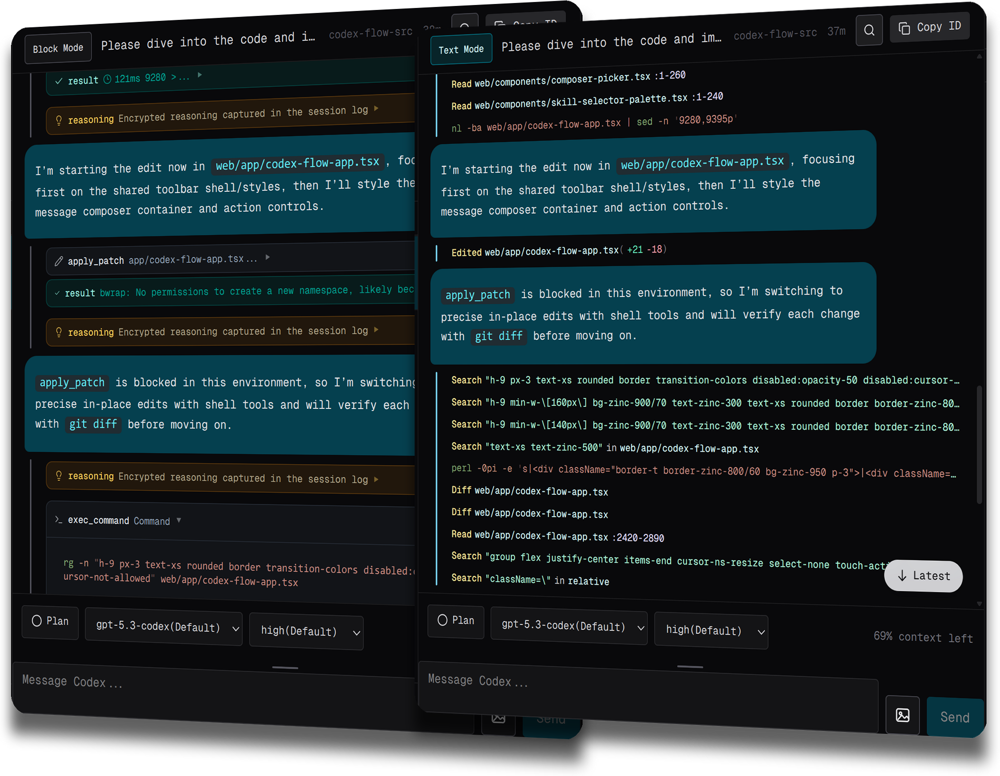
  </div>

- Right panes

  <div align="center">
  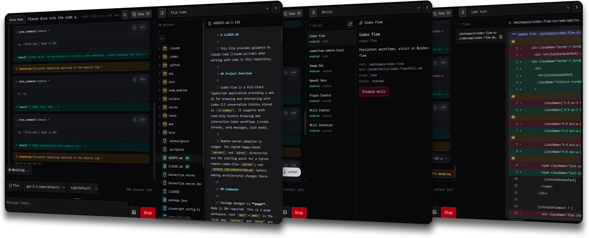
  </div>

- Mobile phone page

  <div align="center">
  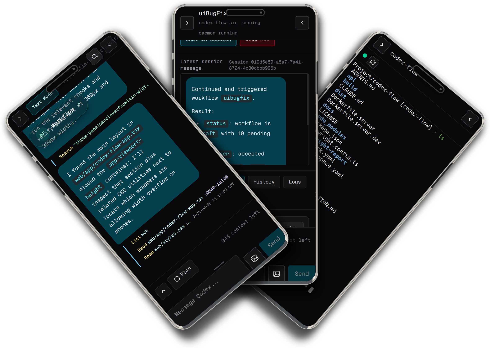
  </div>

- Images support

  <div align="center">
  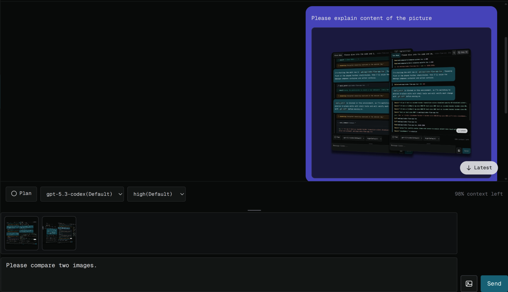
  </div>

- `/`, `@`, and `$` support in the message input box

  <div align="center">
  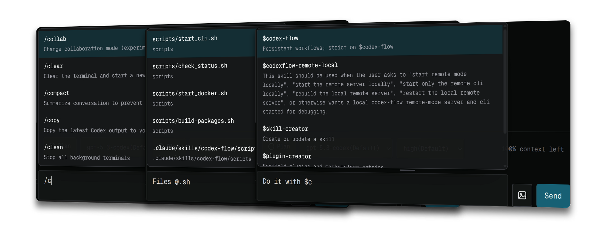
  </div>

- Supported message block views
  - Expanded blocks

    <div align="center">
    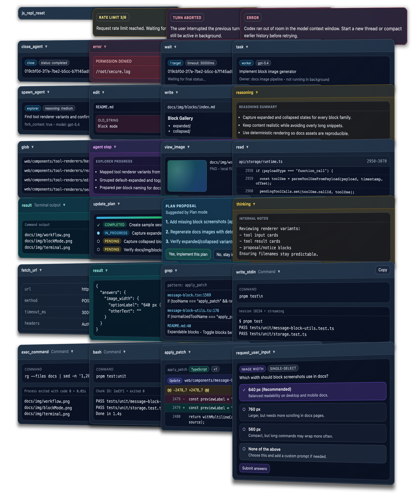
    </div>

  - Collapsed blocks

    <div align="center">
    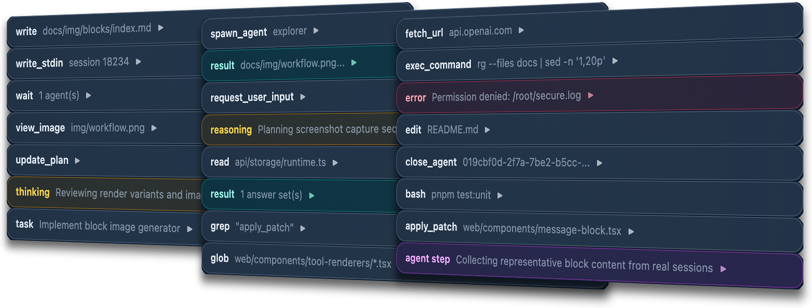
    </div>

## Requirements

- macOS, Linux, or WSL (Windows Subsystem for Linux)
- Node.js 20+
- Codex CLI installed and initialized at least once

Interactive mode uses `codex` under the hood. If `codex` is not on your `PATH`, set:

```bash
export CODEX_CLI_PATH="/absolute/path/to/codex"
```

## Installation (Local mode)

### Option 1: Install globally from npm

```bash
npm install -g codex-deck
```

Run from any directory:

```bash
codex-deck
```

By default, Codex Deck opens `http://localhost:12001` in your browser.

Uninstall:

```bash
npm uninstall -g codex-deck
```

### Option 2: Run from source

```bash
git clone https://github.com/asfsdsf/codex-deck.git
cd codex-deck
npm install -g pnpm
pnpm install
pnpm build
pnpm start
```

Uninstall:

```bash
cd ..
rm -rf codex-deck
```

### Run as a user daemon

From a source checkout, install a native user service for the built local
server:

```bash
./scripts/install-daemon.sh install
codex-deck-daemon start
```

The installer builds the app, then installs a macOS `launchd` agent or a Linux
user `systemd` service. The service runs the built server with `--no-open`, so
it does not try to open a browser in the background. Installation leaves the
service stopped; start it explicitly with `codex-deck-daemon start`. If
`~/.local/bin` is not on `PATH`, use the full path printed by the installer or
add it to `PATH`.

Manage the service with:

```bash
codex-deck-daemon status
codex-deck-daemon stop
codex-deck-daemon restart
```

After changing the source, rebuild and restart it:

```bash
pnpm build
codex-deck-daemon restart
```

The Web UI also provides **Settings → Updates** for an update-and-restart flow:

- **npm release** checks the `latest` npm version, installs the release into a
  versioned directory under the daemon state directory, switches the daemon to
  that validated release, and restarts it.
- **Source project** runs a frozen `pnpm install` and `pnpm build` against the
  selected codex-deck project root, switches the daemon to that build, and
  restarts it. It intentionally uses the source already on disk and does not
  run `git pull` or require a version check.

The initial source-project field is the directory from which the most recent
`codex-deck-daemon start` command was run. Choose another project root in the
Updates tab when that directory is not the desired codex-deck checkout. A
daemon installed by an older version at the standard state and command paths
upgrades its runner on the first Web UI update. Reinstall a daemon that uses
custom state or command paths so it can expose those paths to the updater.

The status output includes the main Codex home's
`codex-deck/config.toml` path. The server log is written to
`~/.local/state/codex-deck/server.log`. To provide service-only environment
variables such as `CODEX_HOME` or remote connection settings, pass a shell
environment file during installation:

```bash
./scripts/install-daemon.sh install --env-file ~/.config/codex-deck/server.env
```

The equivalent package commands are `pnpm daemon:install`,
`pnpm daemon:start`, `pnpm daemon:stop`, `pnpm daemon:restart`, and
`pnpm daemon:status`. Remove the service with
`codex-deck-daemon uninstall`.

### Option 3: Use a release package

Download `codex-deck-vX.X.X-[arch]` from the [GitHub Releases page](https://github.com/asfsdsf/codex-deck/releases), extract it, and run the `codex-deck` executable from that directory.

Uninstall:

```bash
rm -rf codex-deck-vX.X.X-[arch]
```

No matter which local installation method you use, `codex-deck` supports these options:

```text
codex-deck [options]

Options:
  -V, --version        Show version number
  -p, --port <number>  Port to listen on (default: 12001)
  -d, --dir <path>     Codex directory path (default: $CODEX_HOME or ~/.codex)
  --dev                Enable CORS for development (frontend at localhost:12000)
  --no-open            Do not open browser automatically
  -h, --help           Show help
```

### Config file

codex-deck also reads optional TOML config files:

1. `./config.toml` (current working directory)
2. `<main-codex-home>/codex-deck/config.toml`

The main Codex home is the directory selected when the server starts, using `--dir`, the configured `dir`, `CODEX_HOME`, or `~/.codex`. Both files are read when present and merged per key: a key set in `./config.toml` wins, and keys only set in the main Codex home's config still apply.

When the same option is set in multiple places, the priority is: command-line arguments > environment variables > config file > built-in defaults.

```toml
port = 12001
dir = "/path/to/codex-home"
dev = false
open = true
translation_command = "translate-command $PROMPT"

[codex_homes.work]
path = "/path/to/work-codex-home"
label = "Work"

[codex_homes.personal]
path = "/path/to/personal-codex-home"
label = "Personal"

[remote]
server_url = "https://your-server-host"
username = "your-username"
password = "your-password"
setup_token = "your-setup-token"
machine_id = "stable-machine-id"        # optional
pinned_realm_id = "realm-id"            # optional
pinned_opaque_server_key = "public-key" # optional
```

All keys are optional. The `[remote]` keys mirror the `--remote-*` flags and `CODEXDECK_REMOTE_*` environment variables.

Additional Codex homes are declared only by the main config with named `[codex_homes.<id>]` tables. Each available home appears in the selector at the top of the left pane. Missing directories, duplicate paths, reserved IDs, and other invalid entries remain visible but disabled.

The web app's Settings button at the bottom of the left pane opens a structured editor for server startup, the floating message tip, translation, additional Codex homes, remote connection settings, and daemon updates. The Updates tab can check npm for a newer release or rebuild a selected source checkout, then activate the result and restart the daemon. An Advanced section remains available for direct TOML editing. Applying changes writes `<main-codex-home>/codex-deck/config.toml`, updates `[conversation_hover]`, `translation_command` and the additional Codex home catalog immediately, and preserves unrelated TOML when structured controls are used. Startup and remote settings (`port`, `dir`, `dev`, `open`, and `[remote]`) are saved but require restarting codex-deck; the UI lists the affected keys after applying.

**Settings → Floating tip** controls each hover field independently and can disable the tip entirely. Available details include numbering, local time, token counts, cache reuse percentage, context usage, model, reasoning effort, service tier, tool duration, command exit code, original tool output tokens, output truncation, and goal usage. Model, reasoning effort, and service tier are off by default; other fields are on. Missing values stay hidden, and collapsed text-mode rows do not show the tip. Context usage uses that call's recorded token count and context capacity; model settings come from the historical turn rather than the current composer selection. Tool measurements come from recorded tool envelopes, with timestamps used as a fallback for duration.

The same switches are available in TOML. All are optional, and `./config.toml` overrides the main home's file per field. For example:

```toml
[conversation_hover]
enabled = true
model = true
reasoning_effort = true
service_tier = true
cache_hit_rate = true
context_usage = true
cache_creation_tokens = false
timestamp = false
```

See [config.toml.example](config.toml.example) for every field name. These display settings belong to the main config and apply across Codex homes. Local clients reuse the shared sessions SSE connection for settings updates, and remote clients use encrypted polling. Direct file edits and updates in additional-home runtimes are picked up within five seconds in local mode and on the next remote settings poll. No restart is needed.

Each home runs in an isolated runtime with its own sessions, Codex app-server process, terminals, workflows, skills, pets, memories, live updates, and browser state. Only the main codex-deck process opens a network port; additional homes communicate with it over internal process IPC. Switching homes resets model, reasoning effort, and collaboration mode controls to the target home's Codex defaults.

Startup and remote settings (`port`, `dir`, `dev`, `open`, and `[remote]`) always come from the main config. Runtime settings may be overridden by the selected home's own `codex-deck/config.toml`; currently this applies to `translation_command`. If the selected home does not set it, the main config value is used.

## Installation (Remote mode)

Quick map:

- `Server machine` (Docker host): runs remote `server` and hosts the web app.
- `Local machine` (where Codex runs): starts `codex-deck` CLI and connects to server.
- `Web page` (browser): signs in and controls connected local machines.

Security note:

- Synced Codex payloads are encrypted between `local machine` and `web page`; the `server` stores encrypted blobs plus routing metadata.
- If you open the web app directly from the server URL, that server controls the JavaScript sent to your browser. So only use the server-hosted web URL when you trust that server/operator.
- Use `https://` in real deployments. Use `http://` only for trusted local/lab testing.

### 1. Server machine: build and run

Clone the repository and enter the project root on the server machine:

```bash
git clone https://github.com/asfsdsf/codex-deck.git
cd codex-deck
```

Build the remote server image:

```bash
docker build -t codexdeck-server -f Dockerfile.server .
```

Server environment variables (used in this step):

- `CODEXDECK_REMOTE_ADMIN_PASSWORD` (required): password for `https://your-server-host/admin`.
- `CODEXDECK_REMOTE_SETUP_TOKENS` (optional): comma- or newline-separated setup tokens to seed on first boot. You can also create tokens later in the admin page.
- `PUBLIC_URL` (recommended): the public URL users and CLIs use to reach this server (use `https://...` in production).
- `CODEXDECK_REMOTE_BROWSER_AUTH_PERSISTENCE` (optional): browser login persistence. `session` ends on browser close, `remember` persists.

Run the server:

```bash
docker run -p 3005:3005 \
  -e CODEXDECK_REMOTE_ADMIN_PASSWORD=<admin-password> \
  -e CODEXDECK_REMOTE_BROWSER_AUTH_PERSISTENCE=remember \
  -e PUBLIC_URL=https://your-server-host \
  -v codexdeck-data:/data \
  codexdeck-server
```

This container serves both the remote web app and remote server. Data is stored in `codexdeck-data`.

### 2. Web page: create setup tokens

In a browser, open `https://your-server-host/admin`, log in with `CODEXDECK_REMOTE_ADMIN_PASSWORD`, and create one setup token for each local CLI you want to connect. If you prefer, you can still pre-seed tokens with `CODEXDECK_REMOTE_SETUP_TOKENS` before first boot.

### 3. Local machine: connect each Codex machine

On each local machine (the machine that has Codex CLI history), start `codex-deck` like this:

```bash
codex-deck \
  --remote-server-url https://your-server-host \
  --remote-setup-token <token-a> \
  --remote-username <cli-login-name> \
  --remote-password <cli-login-password>
```

### 4. Web page: sign in

Open `https://your-server-host/` in a browser and sign in with the same remote username and password used for that local machine.

## Guided Git diffs

Use `/codex-deck-diff` or `/ai-diff` in a session composer to fork the conversation and generate a guided tour of its repository's current Git changes. You can add a request, for example `/ai-diff --branch main Explain the API changes`. Enter and the Run button both execute the command. Bound Workflow and Terminal composers also support it.

If `codex-deck-diff` is missing, choose **Install locally**, **Install globally**, or **Cancel**. The fork runs in normal mode even when its parent uses Plan mode; the parent continues unchanged. A disabled installation must be enabled in Skills settings first. Git and Python 3 must be available on the CLI machine.

The fork has a **diff guide** badge in the session list. Use **Origin session** at the top left of the conversation to return to the source session, or **Diff guide** at the top right to open the full-screen viewer. These buttons work in local and remote mode, including mobile browsers. Incomplete or failed generation can be retried in the same fork. For an empty diff, read the explanation in the conversation. Embedded comments support export; persistent browser storage may be unavailable in the isolated viewer.

Artifacts live on the CLI machine under the active `$CODEX_HOME/codex-deck/diff/sessions/<forkSessionId>/`: `snapshot.json`, `guide.json`, and `diff-tour.html`. Each invocation creates a separate fork marked with a **diff guide** badge in the session list. Archiving preserves these files. When deleting the fork, choose **Delete session only** to retain the saved guide files, or **Delete session + diff guide** to remove them too. Retained HTML can be opened directly from its artifact directory. The default comparison is HEAD against current staged, unstaged, and non-ignored untracked code. A requested commit, branch, or tag is compared directly against current code.

## AI Terminal usage

You can chat with Codex at any time while working in the terminal.

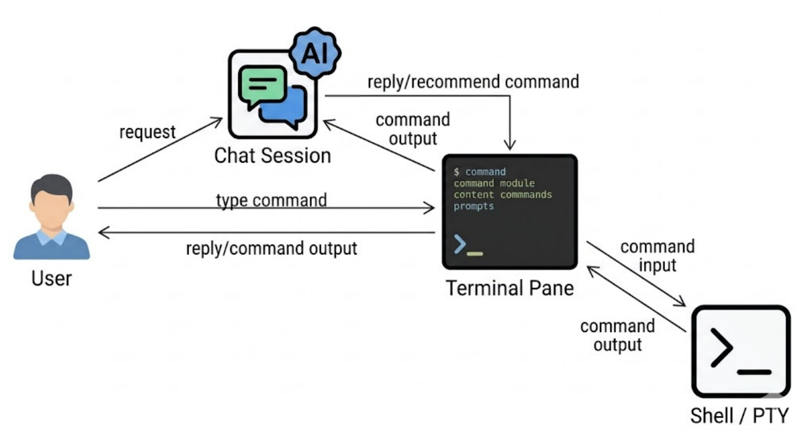

To use AI Terminal:

1. Click `Terminal` in the left pane.
2. Click `New Terminal`.
3. Alternate between typing shell commands and chatting with the Codex session.

You can also:

- Click `Chat in session` to see the detailed steps in the Codex session.
- Click `Continue` to let the Codex session continue.

## Workflow usage

Using workflows is as easy as chatting.

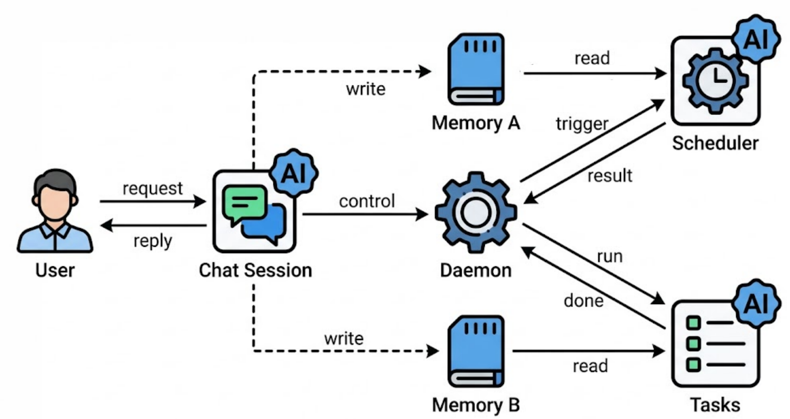

To create a new workflow:

1. Click `Workflow` in the left pane.
2. Click `New Workflow`.
3. Describe what you want in the chat.

Example chat requests (user side only):

- **Ask questions**: "How do I use the codex-deck-flow workflow system?"
- **Create tasks**: "Create a workflow to add GitHub OAuth login with backend API updates, frontend UI changes, and tests."
- **Create tasks**: "Create 10 tasks. Each task should dive into the project, find a frontend UI bug, and fix the code until all unit tests pass."
- **Add tasks**: "Add a task to make a better improvement based on the previous task."
- **Merge git worklist**: "Merge the tasks."
- **Show task status**: "Summarize task running status."
- **Add memory to agents**: "Fix the code until all unit tests pass for all tasks in all workflows."
- **Diagnose workflow**: "Workflow fails to run. Please fix it."

> **Notes:** `sandbox_mode = "danger-full-access"` is enabled for workflow agents.

Requirements:

- Run inside a Git repository.
- Skill codex-deck-flow is installed.

## Development

```bash
git clone https://github.com/asfsdsf/codex-deck.git
cd codex-deck
pnpm install
pnpm build
pnpm dev
```

`pnpm dev` starts:

- frontend at `http://localhost:12000`
- backend at `http://localhost:12001`

## Build portable packages

```bash
pnpm build:packages
```

This builds portable archives in `./build/` for:

- `macos-arm64`
- `macos-x64`
- `linux-x64`

On non-Linux hosts, `linux-x64` packaging requires Docker because `node-pty` must be installed on Linux.

Limit targets with:

```bash
./scripts/build-packages.sh --targets macos-arm64,macos-x64
```

## Acknowledgements

- Server design inspiration: [slopus/happy](https://github.com/slopus/happy)
- Web theme inspiration: [kamranahmedse/claude-run](https://github.com/kamranahmedse/claude-run)

## License

MIT © zzami
